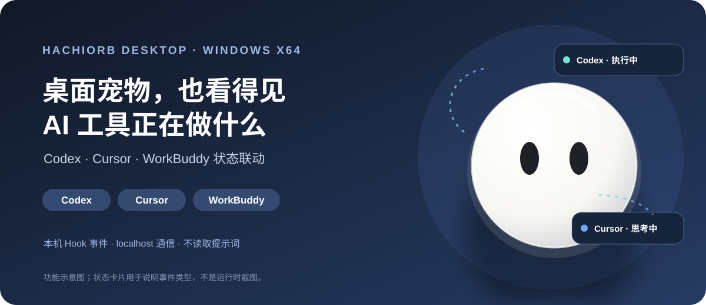
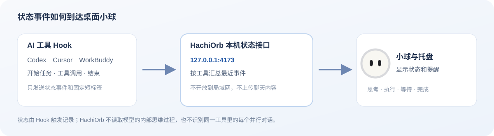

# HachiOrb Desktop — Windows 桌面宠物与 AI Agent 状态球

 [](https://github.com/AshinTop/hachiorb-desktop/releases/latest) [](https://github.com/AshinTop/hachiorb-desktop/releases)

HachiOrb 是 Windows 桌面悬浮宠物（desktop pet），也为 **Codex、Cursor、WorkBuddy 和 Grok Bot** 提供轻量的本机 AI Agent 状态显示。小球把思考、执行、等待授权和完成等 Hook 事件带到桌面，让你不用一直切换窗口也能知道 AI 工具最近在做什么。



> 上图为功能示意图，不是应用运行截图；状态卡片用于展示支持的事件类型。

## 功能一览

| 功能 | 说明 |
|---|---|
| **Windows 桌面宠物** | 无边框、透明背景、悬浮小球；拖到桌面的任意位置。动画采用 [TyCoding/grok-ball](https://github.com/TyCoding/grok-ball) 原版 SVG / JavaScript 引擎。 |
| **桌面交互** | 鼠标移动时眼睛跟随；轻点旋转；托盘菜单提供 32 种表情、尺寸、置顶、鼠标穿透、隐藏和退出。 |
| **AI Agent 状态监控** | 通过 Hook 接入 Codex、Cursor、WorkBuddy；支持 thinking、working、等待授权、完成和错误等状态事件。Grok Bot 可显式发送状态。 |
| **多工具并行状态** | 不同 AI 工具分别保留最近状态；托盘可查看各工具的最近上报记录。 |
| **本机优先和隐私** | 状态接口绑定 `127.0.0.1`；Hook 只发状态类型和固定短标签，不读取或上传提示词、聊天正文、代码、工具参数或密钥。 |

### AI 状态联动的工作方式



状态来自 AI 工具实际触发的 Hook，不代表读取模型内部思维过程。当前按 AI 工具汇总状态，同一个工具里的多个并行对话不会分别显示。HachiOrb 不会自动批准权限请求，也不会把状态内容发送到互联网。

## 下载和安装 Windows 便携版

从 [GitHub Releases](https://github.com/AshinTop/hachiorb-desktop/releases/latest) 下载 `HachiOrb-1.3.1-win32-x64.zip`。此版本是 **Windows x64 便携包**，没有安装向导。

1. 将 ZIP **完整解压**到固定目录，例如 `C:\Apps\HachiOrb`。不要直接在压缩包里运行，也不要只复制 `HachiOrb.exe`；程序运行依赖必须和 EXE 放在一起。
2. 双击解压目录中的 `HachiOrb.exe`。桌面会出现动态表情球，系统托盘会显示 HachiOrb 图标。
3. 右键小球或托盘图标打开菜单；按住鼠标左键拖动小球可调整位置。

运行桌宠本身不需要安装 Node.js。当前构建未进行 Windows 代码签名，SmartScreen 可能显示未知发布者；请从本项目 Release 下载，并使用同一页面提供的 `.sha256` 文件核对 ZIP。

## 安装 Codex、Cursor 和 WorkBuddy Hook

若要让 AI 工具上报状态，需要 **Node.js 22 或更新版本**。这是 Hook 安装的运行环境要求，不是 HachiOrb 桌宠的运行要求。

1. 先启动 `HachiOrb.exe`。
2. 在解压目录双击 `setup-agent-hooks-windows.bat`。请使用与 Codex、Cursor 和 WorkBuddy 相同的 Windows 用户账户运行。
3. 安装完成后，完全退出并重启对应的 AI 工具，再提交一条新任务测试。

安装器会自动配置 Codex 生命周期 Hook、Cursor Hook，并把 HachiOrb 本地 Hook 插件注册到 WorkBuddy Desktop。它会保留已有 Codex `notify` 和其他工具的 Hook；改动配置前会创建 `.hachiorb-backup-*` 备份。遇到格式不支持或配置冲突时，安装器会报告错误，不强行覆盖。

没有 Node.js 时，PowerShell 后备安装方式可配置 Codex 和 Cursor；WorkBuddy Desktop Hook 需要 Node.js。为了一次配置三个工具，请先安装 Node.js 22+。WorkBuddy 必须完全退出（包括托盘进程）后再重启，才能加载插件。

`test-agent-connection-windows.bat` 可以检查 HachiOrb 本机状态接口是否可连接。连接测试成功只说明本地接口可用，不代表 AI 工具 Hook 已触发。

## 状态和隐私

AI Hook 把事件发送到本机状态接口 `http://127.0.0.1:4173/api/state`。若默认端口已占用，HachiOrb 会尝试 `4174` 或 `4175`，实际端口可从系统托盘查看。只有 HachiOrb 正在运行时才能收到新的事件；之前发生的事件不会回放。

Hook 仅用于传递 Agent 状态，不读取或上传提示词、聊天正文、生成代码、工具参数或密钥。首次启动可能联网下载经校验的上游动画引擎；后续缓存后可以离线运行。

## 常见问题

- **小球没有出现：** 确认 `HachiOrb.exe` 仍在运行，检查系统托盘的 HachiOrb 图标，并从菜单恢复桌宠显示。
- **AI 正在工作，但小球没变化：** 确认 HachiOrb 已启动；重新运行 Hook 安装器；完整退出并重启对应 AI 工具；用新任务触发 Hook。安装脚本的输出会说明成功或具体错误。
- **WorkBuddy 一直显示待机：** 检查安装器是否成功注册 WorkBuddy 插件，确认 `node --version` 为 22 或更新版本，然后完全退出 WorkBuddy 再打开。
- **连接测试通过，状态仍不变化：** 连接测试只检查本机接口。还需确认 AI 工具触发了 Hook，并在事件发生时保持 HachiOrb 运行。
- **提示配置格式不支持：** 安装器会保留原文件；检查配置目录中的 `.hachiorb-backup-*` 备份，再按照错误信息手动合并。

## 更新 HachiOrb

1. 退出正在运行的 HachiOrb。
2. 下载新版 ZIP 并完整解压到新目录，保留解压目录中的全部文件。
3. 启动新版 `HachiOrb.exe`。新版若包含 Hook 修复，再运行新版 `setup-agent-hooks-windows.bat`，然后重启对应 AI 工具。

## 从源码构建

需要 Windows x64、Node.js 22+ 和首次下载上游动画资源时的网络连接：

```powershell
npm ci
npm run fetch:engine
npm test
npm run pack:win
```

便携构建目录是 `release/HachiOrb-win32-x64`，其中的 `HachiOrb.exe` 需要与整个目录一起分发。

## v1.3.1

- 自动注册 WorkBuddy Desktop 的 HachiOrb 本地 Hook 插件，减少手动设置步骤。
- 修复便携包中 Hook 安装脚本缺少版本信息的问题。
- 修复拖动小球时尺寸变化的问题。
- 补充 Codex、Cursor、WorkBuddy 的安装步骤、重启说明和故障排查。

动画引擎来自 [TyCoding/grok-ball](https://github.com/TyCoding/grok-ball)，其 MIT 许可证见 [`third_party/LICENSE.grok-ball`](third_party/LICENSE.grok-ball)。HachiOrb 是社区项目，不代表 xAI、OpenAI、Cursor 或 WorkBuddy 官方产品。
